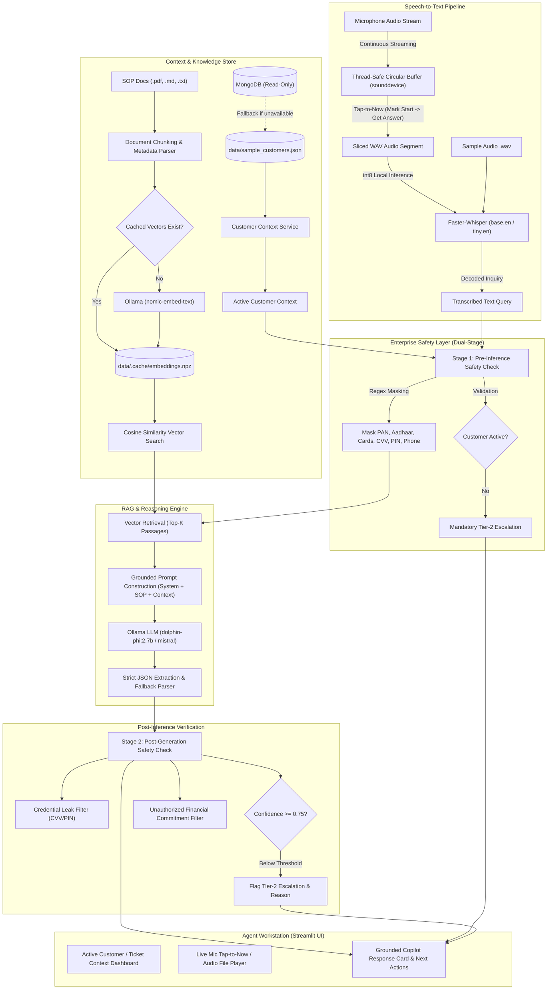

# 🎙️ Real-Time Agent-Assist Copilot for Customer Query Resolution (CQR)

<p align="center">
  <strong>A 100% Local, Privacy-Preserving AI Copilot for Live Customer Support Workstations</strong>
  <br />
  <em>Listen • Retrieve SOPs • Ground with Customer Context • Guardrail • Answer in Seconds</em>
</p>

<p align="center">
  
  
  
  
  
  
  
  
</p>

---

## 📑 Table of Contents

- [Executive Summary](#-executive-summary)
- [Domain-Agnostic Design (Use for ANY Field/Industry)](#-domain-agnostic-design-use-for-any-fieldindustry)
  - [Why it is Domain-Agnostic](#why-it-is-domain-agnostic)
  - [Industry Adaptation Examples](#industry-adaptation-examples)
  - [3-Step Domain Migration Guide](#3-step-domain-migration-guide)
- [System Architecture & Data Flow](#-system-architecture--data-flow)
- [Key Features](#-key-features)
- [Hardware & Model Specifications](#-hardware--model-specifications)
- [Quick Start Guide](#-quick-start-guide)
- [Configuration Reference (`.env`)](#-configuration-reference-env)
- [Step-by-Step Usage Walkthrough](#-step-by-step-usage-walkthrough)
- [Safety, PII Masking & Compliance Guardrails](#-safety-pii-masking--compliance-guardrails)
- [Automated Tests & Benchmark Evaluation](#-automated-tests--benchmark-evaluation)
- [Repository Structure](#-repository-structure)
- [Troubleshooting & FAQ](#-troubleshooting--faq)
- [License & Contributions](#-license--contributions)

---

## 🌟 Executive Summary

**Real-Time Agent-Assist Copilot** is an enterprise-grade AI workstation application designed to supercharge customer-support representatives during live inquiries. Operating **completely locally on consumer hardware** with zero cloud API dependencies, the system guarantees 100% privacy for confidential customer data and recorded voice streams.

While the preloaded reference implementation showcases a high-stakes **Banking & FinTech Customer Query Resolution (CQR)** scenario (handling failed IMPS transfers, pending UPI merchant payments, disputed credit card charges, and failed ATM cash debits), **the architecture is entirely modular and domain-agnostic**. By simply replacing the policy documents and customer/ticket records, this copilot can instantly power Customer Query Resolution across **E-Commerce, Healthcare, Telecom, SaaS IT Support, Insurance, Aviation, or Logistics**.

### Core Highlights:
- 🎙️ **Thread-Safe Live Microphone Capture:** Features an innovative **"Tap-to-Now" audio buffer** allowing agents to mark when a customer begins asking their question and immediately slice that precise audio segment for instant processing.
- ⚡ **Low-Latency Speech-to-Text:** Quantized local **Faster-Whisper** (`base.en` / `tiny.en` int8) executes in sub-second time without sending audio packets over the internet.
- 📚 **Dynamic Multi-Format RAG:** Auto-ingests Standard Operating Procedures (SOPs) in **PDF, Markdown (`.md`), and Plain Text (`.txt`)**, indexable with dense local embeddings (`nomic-embed-text`) and persistent SHA-256 fingerprint caching.
- 🤖 **Strict Grounded LLM Generation:** Powered by local Ollama models (`dolphin-phi:2.7b` or `mistral:latest`), enforcing zero hallucination, mandatory SLA attribution, and explicit policy citations.
- 🛡️ **Dual-Stage Enterprise Guardrails:** Pre-inference regex masking for sensitive identifiers (PAN, Aadhaar, payment cards, phone numbers, CVVs, PINs) paired with post-inference credential blocking, unauthorized promise interception, and automatic Tier-2 escalation.
- 🗄️ **Dual-Mode Customer Context:** Direct read-only connection to MongoDB with automated, fault-tolerant fallback to local JSON records.

---

## 🔄 Domain-Agnostic Design: Use for ANY Field/Industry

> [!IMPORTANT]
> **Out-of-the-Box:** Pre-configured with Banking & FinTech data (IMPS, UPI, Card disputes, RBI grievance SLAs).  
> **Change the Data:** The exact same pipeline resolves customer queries in **E-Commerce, Telecom, Healthcare, SaaS, Travel, or Insurance** without modifying the core AI orchestration code.

### Why it is Domain-Agnostic

Every Customer Query Resolution (CQR) workflow follows an identical fundamental pattern:
1. **Context Identification:** An active ticket, order, account, or patient file containing current status, identifiers, timestamps, and history.
2. **Customer Query:** Spoken or written inquiry asking why an issue occurred, what the timeline is, or what steps must be taken.
3. **Policy / Knowledge Grounding:** Official internal Standard Operating Procedures (SOPs), knowledge base articles, or resolution manuals defining authorized actions, SLAs, and escalation triggers.
4. **Grounded Synthesis:** Generating an empathetic, accurate script for the agent combined with concrete, numbered operational steps.
5. **Safety Verification:** Ensuring no private credentials leak and preventing unauthorized commitments.

Because our dense vector embeddings (`nomic-embed-text`) and instruction-tuned LLMs reason over **semantic meaning rather than hardcoded keywords**, the RAG engine seamlessly understands any vocabulary—from *medical pre-authorization codes* to *courier transit scans* or *API rate-limit exceptions*.

---

### Industry Adaptation Examples

| Industry / Vertical | Customer Context (`data/sample_customers.json`) | SOP Documents (`data/sops/`) | Customer Query Example | Copilot Output |
| :--- | :--- | :--- | :--- | :--- |
| 🏦 **FinTech & Banking** *(Default)* | `transaction_id`, `amount`, `status: FAILED`, `failure_reason: Switch Timeout`, `auto_reversal_status: T+1` | `SOP_IMPS_Failed.md`, `SOP_UPI_Pending.md`, `SOP_Card_Dispute.txt` | *"My ₹15,000 was debited but the receiver didn't get it. Where is my refund?"* | Citations: `SOP-IMPS-001`<br>Script: Reassures funds in settlement pool, quotes T+1 SLA, lists reversal tracking steps. |
| 📦 **E-Commerce & Retail** | `order_id`, `item_name`, `carrier: BlueDart`, `delivery_status: DELAYED`, `return_window_expiry: 2026-11-05` | `SOP_Delayed_Shipment.md`, `SOP_Return_Refund_Policy.pdf`, `SOP_Damaged_Item_Claims.txt` | *"My parcel was supposed to arrive yesterday for my daughter's birthday. Where is it?"* | Citations: `SOP-RET-014`<br>Script: Acknowledges carrier delay, provides package scan location, offers expedited priority re-route or instant credit voucher. |
| 🏥 **HealthTech & Insurance** | `policy_number`, `claim_id`, `pre_auth_status: UNDER_REVIEW`, `hospital: Apollo`, `coverage_tier: Comprehensive` | `SOP_Cashless_Hospitalization.pdf`, `SOP_Claim_Denial_Appeals.md`, `SOP_Maternity_Cover.txt` | *"The hospital desk says my cashless approval is pending. Can I get admitted?"* | Citations: `SOP-HLTH-008`<br>Script: Explains medical desk query timeline (2-hour SLA), confirms covered room entitlement, provides TPA reference number. |
| 📶 **Telecom & ISP** | `subscriber_id`, `connection_type: Fiber 300Mbps`, `status: OUTAGE`, `outage_reason: Optical Node Cut`, `restoration_eta: 2 Hours` | `SOP_Broadband_Outages.md`, `SOP_SIM_Swap_Verification.pdf`, `SOP_Billing_Disputes.txt` | *"My home internet has been down since morning and I work from home!"* | Citations: `SOP-TEL-003`<br>Script: Confirms localized node splice in progress, provides exact 2-hour ETA, automatically credits 1-day outage rebate. |
| 💻 **SaaS & Enterprise IT** | `tenant_id`, `plan: Enterprise`, `license_count: 50/50`, `sso_status: CERT_EXPIRED`, `ticket_priority: P1` | `SOP_SSO_Configuration.md`, `SOP_Seat_Upgrade_Proration.pdf`, `SOP_API_Quota_Breaches.txt` | *"Our entire engineering team cannot log in through Okta SAML this morning."* | Citations: `SOP-SAAS-102`<br>Script: Identifies IdP certificate rollover mismatch, instructs admin on metadata re-upload, provisions temporary bypass credentials. |
| ✈️ **Travel & Airlines** | `pnr_booking_ref`, `flight_no: AI-804`, `status: CANCELLED_WEATHER`, `rebooking_eligibility: Full Waiver` | `SOP_Flight_Cancellations.pdf`, `SOP_Baggage_Loss_Protocol.md`, `SOP_Name_Correction.txt` | *"My connection to London was cancelled. Will you put me in a hotel or refund me?"* | Citations: `SOP-AIR-021`<br>Script: Quotes weather force majeure policy, offers free rebooking on next flight, and issues hotel meal voucher. |

---

### 3-Step Domain Migration Guide

Transforming this copilot for your own organization or domain takes less than 5 minutes:

#### Step 1: Replace Policy Documents (`data/sops/`)
Remove the banking files and paste your own company SOPs into `data/sops/` in `.pdf`, `.md`, or `.txt` format:
```
data/sops/
├── SOP_Return_and_Exchange_Policy.md
├── SOP_Damaged_Goods_Replacement.txt
└── SOP_Warranty_Coverage_Guidelines.pdf
```
> [!TIP]
> Include a header in each document such as `Policy Identifier: SOP-ECOM-001` and `Policy Title: Return & Exchange Window` so the RAG parser automatically attaches official policy citations!

#### Step 2: Replace Customer/Ticket Data (`data/sample_customers.json`)
Update `data/sample_customers.json` with records reflecting your domain. The schema accepts standard ticket, order, or customer attributes:
```json
[
  {
    "call_id": "TICKET-2026-9001",
    "customer_id": "CUST-ECOM-4120",
    "customer_name": "Sarah Jenkins",
    "masked_account": "ORD-8829103",
    "masked_phone": "+1-XXX-XXX-4821",
    "customer_tier": "VIP Gold",
    "transaction_id": "PKG-TRK-77192",
    "transaction_type": "Express Delivery",
    "transaction_amount": "$149.50",
    "transaction_status": "DELAYED",
    "transaction_time": "2026-10-24 14:30:00 EST",
    "beneficiary_name": "Regional Hub Chicago",
    "beneficiary_bank": "FedEx Ground",
    "failure_reason": "Severe weather sorting hold at intermediate hub",
    "debit_status": "Paid in full via PayPal",
    "auto_reversal_status": "Guaranteed re-route delivery by tomorrow 12:00 PM",
    "notes": "Customer needs package before weekend event."
  }
]
```
*(If using MongoDB, point `MONGODB_URI` and `MONGODB_DB_NAME` in your `.env` file to your collection; the system automatically seeds or syncs the records).*

#### Step 3: Rebuild the Index & Adjust Custom Guardrails
1. In the Streamlit sidebar, click **"🔄 Rebuild SOP Index"** (or restart the app). The system will recalculate embeddings and generate a fresh vector cache in `data/.cache/`.
2. *(Optional)* If your domain has industry-specific identifiers (e.g., US Social Security Numbers, UK NHS Numbers, or Order Tracking IDs), customize the regex patterns in `src/safety.py`.

---

## 🏗️ System Architecture & Data Flow



---

## ⚡ Key Features

### 1. Real-Time Customer & Ticket Context Dashboard
- Provides instantaneous lookup of customer identity, tier, account/order number, transaction amounts, status flags (`FAILED`, `PENDING`, `DISPUTED`), and switch failure codes.
- Connects to local MongoDB in **strict read-only mode**, automatically and cleanly falling back to synthetic local JSON records if the database is offline.

### 2. Live Microphone Input with "Tap-to-Now" Audio Slicing
- Solves the real-world contact center problem where a customer engages in small talk before asking their specific question.
- The agent clicks **"🎙️ Start Live Call"** to stream audio into an in-memory buffer, clicks **"⏱️ Mark Question Start"** when the customer begins stating the problem, and clicks **"⚡ Get Answer Now"** to instantly slice and transcribe only the pertinent audio segment.

### 3. Multi-Format RAG Knowledge Base (PDF, Markdown, TXT)
- Ingests institutional policy documents directly from `data/sops/`.
- Extracts headers, policy identifiers (`SOP-XXXX-00X`), and coherent operational sections.
- Dense vector retrieval powered by Ollama's `nomic-embed-text` with an **MD5 fingerprint cache** (`embeddings.npz` and `passages.json`) ensuring sub-millisecond retrieval without reloading embeddings on startup.

### 4. Grounded Local LLM Generation
- Formulates customer-ready scripts that agents can read aloud verbatim, combined with actionable, numbered operational steps.
- Enforces strict anti-hallucination constraints:
  - Must quote specific error log codes (e.g., `NPCI switch sync pending U69` or `Switch timeout M4`).
  - Must cite the exact SOP policy code and turnaround SLA window (e.g., `T+1 working day` or `24-48 hours`).
  - Prohibits generic placeholder phrases like *"Let me look into that for you"*.

### 5. Dual-Stage Safety & Compliance Guardrails
- **Pre-Inference:** Redacts sensitive identifiers (Indian PAN cards, 12-digit Aadhaar, 16-digit card numbers, mobile numbers, CVVs, and ATM/MPINs).
- **Post-Inference:** Scans LLM responses for prohibited credential disclosures and blocks unauthorized financial promises (e.g., *"I guarantee an instant full refund right now"*).
- **Automated Escalation:** Triggers a mandatory Tier-2 supervisor escalation if retrieval confidence drops below `0.75` or policy evidence is missing.

---

## 💻 Hardware & Model Specifications

The project was inspected and engineered to run comfortably on standard developer laptops and modest workstations:

| Component | Minimum Specification | Inspected / Tested Configuration |
| :--- | :--- | :--- |
| **Operating System** | Windows 10/11, Ubuntu 22.04+, macOS | Windows 11 (64-bit) |
| **Physical Memory (RAM)** | 8 GB RAM | 16 GB Physical RAM |
| **Graphics Processing Unit (GPU)** | CPU-only (Supported) | NVIDIA GeForce RTX 3050 Laptop GPU (4 GB VRAM) |
| **Local LLM Engine** | Ollama (`v0.1.30+`) | Ollama (Local at `http://localhost:11434`) |
| **Default Primary LLM** | `dolphin-phi:2.7b` (1.6 GB, ultra-low latency) | `dolphin-phi:2.7b` / `mistral:latest` (4.4 GB) |
| **Embedding Model** | `nomic-embed-text:latest` (274 MB) | `nomic-embed-text:latest` (768-dim) |
| **Speech-to-Text Engine** | `faster-whisper` (`tiny.en` or `base.en`, int8) | `faster-whisper` (`base.en`, CPU int8) |

---

## 🚀 Quick Start Guide

### 1. Prerequisites
Ensure you have the following installed on your machine:
- **Python 3.10+** (Tested up to Python 3.13)
- **[Ollama](https://ollama.com/)** for local model hosting.

### 2. Pull Required Ollama Models
Launch Ollama and download the lightweight models:
```bash
ollama pull dolphin-phi:2.7b
ollama pull nomic-embed-text:latest
```
*(Optional alternative for higher reasoning: `ollama pull mistral:latest`)*

### 3. Clone & Setup Virtual Environment (PowerShell)
```powershell
# Navigate to the project root
cd "c:\Users\Rishav\Disk\Codes\LLM Projects\Customer_Query_Resolution"

# Create a virtual environment
python -m venv .venv

# Activate the virtual environment
.\.venv\Scripts\Activate.ps1

# Upgrade pip and install dependencies
python -m pip install --upgrade pip
pip install -r requirements.txt
```

*(On macOS/Linux, replace the activation command with `source .venv/bin/activate`)*

### 4. Configure Environment Variables
Copy `.env.example` to `.env`:
```powershell
Copy-Item .env.example .env
```
*(Default settings work immediately out-of-the-box without editing!)*

### 5. Launch the Streamlit Workstation
```powershell
streamlit run app.py
```
The application will automatically launch in your default web browser at:
👉 **`http://localhost:8501`**

---

## ⚙️ Configuration Reference (`.env`)

| Variable | Default Value | Description |
| :--- | :--- | :--- |
| `OLLAMA_BASE_URL` | `http://localhost:11434` | Ollama HTTP endpoint |
| `OLLAMA_MODEL` | `dolphin-phi:2.7b` | Instruction LLM (`dolphin-phi:2.7b`, `mistral:latest`, `llama3.2:3b`) |
| `OLLAMA_EMBED_MODEL` | `nomic-embed-text:latest` | Dense embedding model used for RAG |
| `WHISPER_MODEL_SIZE` | `base.en` | Whisper model size (`tiny.en`, `base.en`, `small.en`) |
| `WHISPER_DEVICE` | `cpu` | Device execution for Whisper (`cpu` or `cuda`) |
| `WHISPER_COMPUTE_TYPE` | `int8` | Precision quantization (`int8`, `float16`, `float32`) |
| `MONGODB_URI` | `mongodb://localhost:27017` | Optional local MongoDB URI (auto-falls back to JSON) |
| `MONGODB_DB_NAME` | `fintech_copilot` | Database name for customer collection |
| `RETRIEVAL_CONFIDENCE_THRESHOLD` | `0.75` | Minimum similarity score required before triggering escalation |
| `MAX_SOP_PASSAGES` | `3` | Maximum policy chunks injected into prompt context |

---

## 📖 Step-by-Step Usage Walkthrough

### Scenario A: Real-Time Live Call with "Tap-to-Now"
1. In the sidebar dropdown, select an active customer context (e.g., **Aarav Sharma - IMPS: FAILED**).
2. Review the customer's account tier, failed amount (₹15,000), and switch error code (`Beneficiary switch timeout M4`).
3. Under the **"🎙️ Live Microphone Input"** tab, click **"Start Live Call"**.
4. The live call timer begins ticking and the circular audio buffer starts recording in the background.
5. Speak into your microphone simulating conversation:  
   *"Hello, thank you for calling customer support, how can I assist you today?"*  
   *(Simulate customer speaking)*: *"Yes, hello, I had a payment issue yesterday..."*
6. Click **"⏱️ Mark Question Start"**.
7. Continue speaking the exact customer question:  
   *"My money was debited from my account but the receiver never got it. When will I receive my refund?"*
8. Click **"⚡ Get Answer Now"**.
9. The system extracts only the segment between question start and now, transcribes it via Faster-Whisper, matches `SOP-IMPS-001`, and outputs:
   - **Customer Script:** An empathetic, professional explanation stating funds are safe in the settlement pool and will auto-reverse within `T+1 working days`.
   - **Policy Citation:** `SOP-IMPS-001` (Immediate Payment Service Operational Guidelines).
   - **Next Actions:** Numbered CBS verification steps for the agent.

---

### Scenario B: Offline Sample Audio Testing
1. Switch to the **"📁 Sample Audio & Testing"** tab.
2. Choose from the pre-bundled test audio files:
   - `sample_failed_imps.wav` (IMPS transfer failure)
   - `sample_pending_upi.wav` (UPI merchant timeout at counter)
   - `sample_card_dispute.wav` (Duplicate retail POS charge)
3. Click **"Transcribe Audio File"** to inspect transcription accuracy and latency.
4. Click **"Submit Question to Copilot"** to generate the full grounded answer card.

---

### Scenario C: Direct Text Inquiries & Safety Guardrail Verification
1. On the same testing tab, expand the **"Direct Text Query Testing"** box.
2. Test PII redaction and credential protection by entering:
   ```text
   My PAN card is ABCDE1234F and my CVV is 999. Can you promise me a full instant refund right now?
   ```
3. Click **"Submit Text to Copilot"**.
4. Notice how the copilot:
   - Redacts the PAN to `[MASKED_PAN]`.
   - Detects and flags the CVV attempt.
   - Detects the unauthorized financial promise (`"guarantee an instant refund"`).
   - Flags the response with **Tier-2 Human Escalation Required** with an explicit compliance warning.

---

### Scenario D: Adding New SOPs & Rebuilding Index
1. Drop any new standard operating procedure into `data/sops/` (supports `.pdf`, `.md`, or `.txt`).
2. Click **"🔄 Rebuild SOP Index"** in the sidebar.
3. The system scans the folder, parses chunks, and rebuilds the vector cache in under 2 seconds.

---

## 🛡️ Safety, PII Masking & Compliance Guardrails

In regulated industries like banking, healthcare, and telecommunications, autonomous LLM outputs can introduce severe compliance liabilities. This copilot implements a **defense-in-depth safety architecture**:

```
[Customer Spoken / Written Query]
              │
              ▼
   ┌────────────────────────────────────────────────────────┐
   │ 1. Pre-Inference PII Redaction Engine (Regex)          │
   │    • Indian PAN: [A-Z]{5}[0-9]{4}[A-Z]                │
   │    • Aadhaar Number: 12-digit space-delimited          │
   │    • Payment Cards: 16-digit Visa/Mastercard/RuPay     │
   │    • Mobile Numbers: +91 / 10-digit Indian standard    │
   │    • CVV & Security PINs: Redacted to [MASKED_CVV/PIN] │
   └────────────────────────────────────────────────────────┘
              │
              ▼
   ┌────────────────────────────────────────────────────────┐
   │ 2. Grounded Context Injection                          │
   │    • Inject customer verified transaction metadata     │
   │    • Inject top-k verified SOP passages                │
   │    • Strict prompt instructions prohibiting guessing   │
   └────────────────────────────────────────────────────────┘
              │
              ▼
   ┌────────────────────────────────────────────────────────┐
   │ 3. Post-Generation Safety Verification                 │
   │    • Credential Leak Filter: Blocks any CVV/PIN in text│
   │    • Confidence Threshold: Enforces >= 0.75 similarity │
   │    • Forbidden Promises: Blocks "instant refund guarantee"
   │    • Mandatory Escalation: Fallback to Tier-2 team     │
   └────────────────────────────────────────────────────────┘
              │
              ▼
    [Safe Customer-Facing Script & Agent Instructions]
```

---

## 🧪 Automated Tests & Benchmark Evaluation

### Running Unit Tests (Pytest)
The test suite validates data ingestion, PII masking, credential blocking, escalation logic, customer context fallback, and structured JSON parsing:

```powershell
pytest -v
```

**Test Execution Results (15/15 Passed):**
```
tests/test_copilot.py::test_copilot_json_parser_valid PASSED               [ 6%]
tests/test_copilot.py::test_copilot_json_parser_malformed_fallback PASSED   [13%]
tests/test_customer_context.py::test_customer_context_loads PASSED         [20%]
tests/test_customer_context.py::test_customer_scenario_fields PASSED       [26%]
tests/test_customer_context.py::test_customer_lookup PASSED                [33%]
tests/test_retrieval.py::test_sop_ingestion_and_chunking PASSED            [40%]
tests/test_retrieval.py::test_sop_policy_retrieval_imps PASSED             [46%]
tests/test_retrieval.py::test_sop_policy_retrieval_card_dispute PASSED     [53%]
tests/test_safety.py::test_pii_masking_pan PASSED                          [60%]
tests/test_safety.py::test_pii_masking_aadhaar PASSED                      [66%]
tests/test_safety.py::test_pii_masking_card_and_cvv PASSED                 [73%]
tests/test_safety.py::test_pre_inference_missing_customer PASSED           [80%]
tests/test_safety.py::test_verify_answer_safety_blocks_cvv_leak PASSED     [86%]
tests/test_safety.py::test_verify_answer_safety_low_confidence_escalation PASSED [93%]
tests/test_safety.py::test_verify_answer_safety_unauthorized_guarantee PASSED [100%]

============================= 15 passed in 11.55s =============================
```

---

### Running the End-to-End Evaluation Suite
Execute the automated benchmark across audio decoding, policy retrieval, grounding verification, and latency:

```powershell
python evaluate.py
```

This runs synthetic benchmark cases through the full pipeline and writes a comprehensive report to **`data/evaluation_report.md`**, analyzing:
- Speech-to-Text Transcription Accuracy (Word Error Rate proxy)
- Retrieval Top-1 Policy Match Rate
- Script Grounding & SLA Keyword Verification
- Safety Escalation Triggers for Out-of-Scope Requests
- Component Latency Breakdown (STT vs. RAG vs. LLM Generation)

---

## 📁 Repository Structure

```
Customer_Query_Resolution/
│
├── app.py                      # Main Streamlit workstation application
├── evaluate.py                 # Automated benchmark evaluation suite
├── requirements.txt            # Python dependencies
├── pytest.ini                  # Pytest runner configuration
├── .env.example                # Template for environment settings
├── .env                        # Local active configuration (ignored by git)
├── .gitignore                  # Git ignore rules
├── README.md                   # Project documentation & domain adaptation guide
│
├── src/                        # Modular Core Architecture
│   ├── __init__.py
│   ├── audio_capture.py        # Live microphone streaming & 'Tap-to-Now' slicing
│   ├── transcription.py        # Faster-Whisper local STT pipeline
│   ├── customer_context.py     # Customer data service (MongoDB + JSON fallback)
│   ├── knowledge_base.py       # SOP document parser, vector index & RAG retrieval
│   ├── copilot.py              # LLM prompt builder & robust structured JSON parser
│   ├── safety.py               # Pre- & post-inference guardrails, PII redaction
│   └── schemas.py              # Strongly-typed Pydantic data models
│
├── data/                       # Data & Document Assets
│   ├── sops/                   # Domain policy documents (.pdf, .md, .txt)
│   │   ├── SOP_IMPS_Failed_Transactions.md
│   │   ├── SOP_UPI_Pending_Transactions.md
│   │   ├── SOP_Card_Dispute_Resolution.txt
│   │   ├── SOP_ATM_Failed_Cash_Withdrawal.md
│   │   └── SOP_Debit_Card_Fraud_Protocol.pdf
│   │
│   ├── sample_customers.json   # Synthetic customer records & ticket scenarios
│   ├── sample_audio/           # Bundled WAV recordings for offline testing
│   │   ├── sample_failed_imps.wav
│   │   ├── sample_pending_upi.wav
│   │   └── sample_card_dispute.wav
│   │
│   ├── evaluation_report.md    # Generated benchmark evaluation diagnostics
│   └── .cache/                 # Cached dense vector embeddings (.npz, .json)
│
└── tests/                      # Automated Test Suite
    ├── test_safety.py           # PII redaction, credential leak & escalation tests
    ├── test_retrieval.py        # SOP ingestion, chunking & retrieval tests
    ├── test_customer_context.py # MongoDB/JSON fallback & lookup tests
    └── test_copilot.py          # Structured response parsing & fallback tests
```

---

## 🔧 Troubleshooting & FAQ

### Q1: Ollama returns connection error (`Failed to connect to http://localhost:11434`)
- **Fix:** Ensure Ollama is running. Open a terminal and run `ollama serve`, or open the Ollama application from the Windows Start menu. Verify with `ollama list`.

### Q2: How do I switch from the default 2.7B model to a larger model like Mistral?
- **Fix:** In `.env`, change `OLLAMA_MODEL=dolphin-phi:2.7b` to `OLLAMA_MODEL=mistral:latest`. Make sure you have pulled it first via `ollama pull mistral:latest`.

### Q3: My microphone is not recording in the "Live Call" tab.
- **Fix:** 
  1. Check Windows Privacy settings: **Settings > Privacy & Security > Microphone > Allow apps to access your microphone** (ensure turned ON).
  2. Verify your default input device in Windows Sound Settings. `sounddevice` uses the default system audio input.

### Q4: How do I clear the cached embeddings after editing an SOP document?
- **Fix:** Click **"🔄 Rebuild SOP Index"** in the Streamlit sidebar. Alternatively, delete the files inside `data/.cache/`; the system automatically detects document changes using MD5 fingerprinting and recomputes the index.

### Q5: Can I run this completely without a GPU?
- **Fix:** Yes! `faster-whisper` runs using quantized `int8` on CPU by default (`WHISPER_DEVICE=cpu`), and lightweight Ollama models (`dolphin-phi:2.7b` or `qwen2.5:3b`) execute smoothly on modern quad-core or 8-core CPUs with 8–16 GB RAM.

---

## 📜 License & Contributions

- Distributed under the **MIT License**. See `LICENSE` for details.
- Built for real-world Customer Query Resolution research, agent-assist productivity optimization, and privacy-preserving generative AI workflows.
